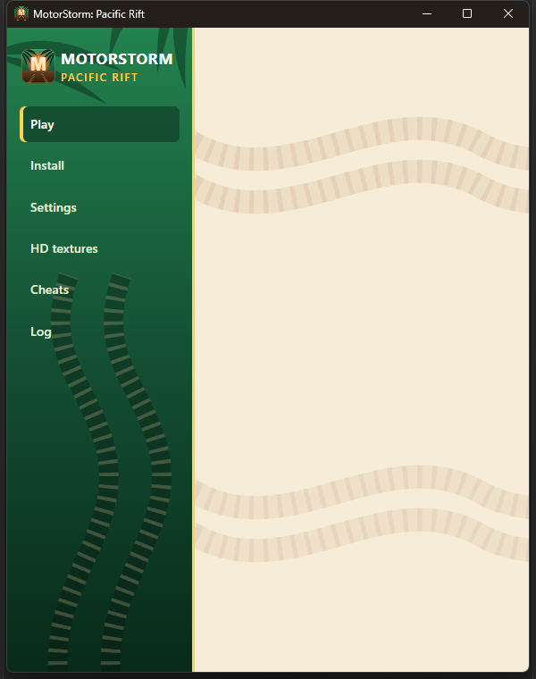
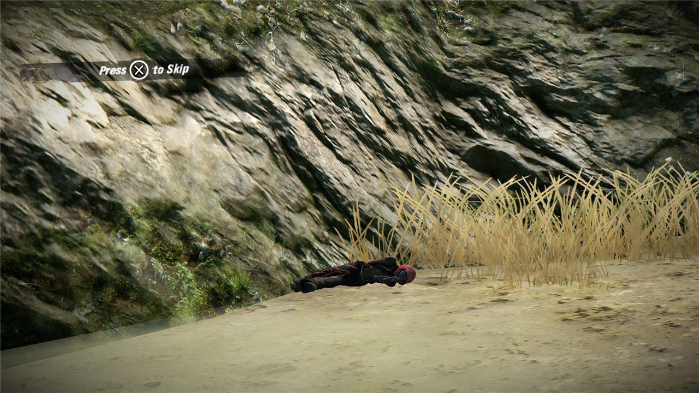
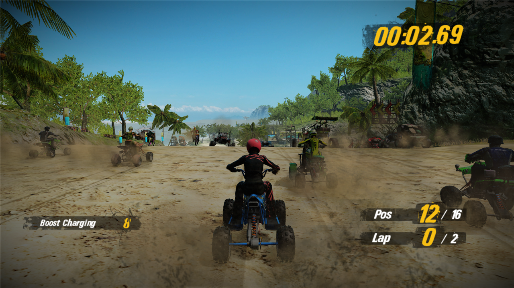

# MotorStorm: Pacific Rift for PC

A PC version of **MotorStorm: Pacific Rift**, the 2008 PlayStation 3 racer. Race ATVs, buggies and trucks through the
Pacific Rift jungle, beaches and canyons, as in the original.

This is an early version (0.2.2, alpha). It runs on Windows 10 and 11 (64-bit). You need your own copy of the game.

<table>
<tr><th>Original lighting, game's own shadows</th><th>Reflections on the sea and cars (Enhanced)</th></tr>
<tr><td></td><td></td></tr>
</table>

> [!IMPORTANT]
> **No game files are included.** You need your own copy of the game and your own decrypted program file (`EBOOT.elf`,
> version 1.00). The launcher checks your files and builds the game on your PC. Nothing from the game is downloaded or
> shared.

## What you need

- Windows 10 or 11, 64-bit.
- A graphics card and driver that support **Vulkan**.
- Your copy of the game (the US disc, BCUS98155), as an `.iso` file or a folder with `PS3_GAME` in it.
- Your `EBOOT.elf` of version 1.00, taken from your own console. No update is needed.
- Free disk space for the build and the game files, and an internet connection for the first install. The launcher downloads its build
  tools from their makers and checks each file.

## Install

1. Download `MotorStormPacificRift.exe` from the
   [latest release](https://github.com/papand7/motorstorm-pacific-rift-native/releases/latest). It is portable: put it in
   a folder of your own, nothing to unzip.
2. Run it and choose your game disc and your `EBOOT.elf`.
3. Press **Install**. The first install takes 30 to 90 minutes. It starts the game briefly once, to capture some
   game code. Do not close the launcher during the install.
4. Press **Play** when the install is done.

Everything is kept in a `MotorStorm` folder beside the launcher. If you update the launcher, install again so the
in-game settings pages match.

If something goes wrong, the launcher writes `launcher.log`. Send that file when you report a problem.

## Controls

The default keys are below. Every action can be changed in **Options > PC Settings > Keyboard** or in the launcher's
Settings page.

| Action | Key |
|---|---|
| Accelerate | W or 2 |
| Brake / reverse | S or 1 |
| Steer left / right | A / D |
| Handbrake | Space |
| Cross button (skip, boost) | Enter or Ctrl |
| Punch left / right | Q / E |
| Camera | C |
| Pause | P or Esc |

Esc pauses the game and does not quit it. A racing wheel and gamepad also work. The on-screen button icons change to
show the keys you have set.

## Settings

The launcher's **Settings** page and the game's own **PC Settings** pages change the same settings file.

| Setting | What it does | Default |
|---|---|---|
| Display | Windowed or fullscreen | Windowed |
| Resolution | Picture size: 720p, 1080p, 1440p or 2160p | 720p |
| Frame rate | 30 FPS matches the original. 45 and 60 FPS are experimental and can show glitches | 30 FPS |
| Fidelity | **Enhanced**: new lighting, ambient occlusion, reflections on water and car paint, tone mapping. **Original**: the game's own lighting | Enhanced |
| Shadows | Original only: Off skips the game's own shadows, for slower PCs. Reflections are not changed. Hidden with Enhanced | On |
| Upscaling | Sharpens a lower-resolution picture. FSR 1, or FSR 3.1 if its files are beside the game | Off |
| Level of detail | Finer models and objects in the distance, at a cost in speed | Original |
| Textures | HD texture pack and PBR materials, made from your own game files on your PC | Off |
| Racing wheel | Wheel steering range, pedals, curve and force feedback | Auto |
| Button prompts | Keyboard icons for the keys you have set, or controller icons | Keyboard |
| Motion blur, filtering, V-sync, HDR | Picture options | Original-style defaults |

Each setting shows a note on its page when something it needs is missing.

**Cheats** (launcher, **Cheats** tab, both off by default):
- **Unlock all vehicles** opens every vehicle class and ticket.
- **Unlock all tracks** opens the Free Play track list.

Turning a cheat off returns your saves to how they were.

## Cockpit view

Press **C** to cycle the cameras. The cockpit view puts you in the driver's seat. Some vehicles have tuned positions;
the others use the default for their class. While the cockpit view is on, you can move the camera live:

- **I / K**: forward and back
- **J / L**: left and right
- **T / G**: up and down
- **, / .**: tilt
- **M / N**: turn
- **O / U**: zoom (hold Shift to go faster, Num 0 for finer steps)
- **F2**: save your position. The next install keeps it.

## Known issues

- **Shadows:** the game's own shadows are used. The new world shadows are not finished and are off in this release. Some shadows can seem to follow the camera with Enhanced fidelity; under review.
- **Blocky fire** on burning vehicles: under investigation.
- **Water** can look too bright in some races with Enhanced lighting.
- **Garage:** the vehicle editing screen may show nothing. A fix is in progress.
- **Cheats:** Unlock all tracks covers the Free Play list only. Festival and Time Trial lists stay locked.
- **Exposure:** the picture can flash briefly too bright or too dark.
- **60 FPS and above** can show camera and shadow glitches. 30 FPS is the recommended setting.
- **Button prompts:** the keyboard key icons are still being tested and may show the original icons.
- **Racing wheels:** supported, but not yet tested on real hardware.

## Not in this release

- Online and LAN multiplayer.
- Gamepad rebinding (keys are changed on the keyboard only).

## Credits and licences

- **ps3recomp** by sp00nznet: the translation framework this port is built on (MIT).
- **AMD FidelityFX** (FSR 1 and FSR 3.1), **DirectX Shader Compiler** (Microsoft), and the build tools the launcher
  downloads from their makers.

The full list is in [THIRD_PARTY_LICENSES.md](THIRD_PARTY_LICENSES.md). This project contains none of MotorStorm's game
code or files. MotorStorm belongs to its owners; this port is not affiliated with Sony Interactive Entertainment or
Evolution Studios.

For developers: the build notes are in [docs/LAUNCHER.md](docs/LAUNCHER.md) and the status records in
[docs/STATUS.md](docs/STATUS.md).
