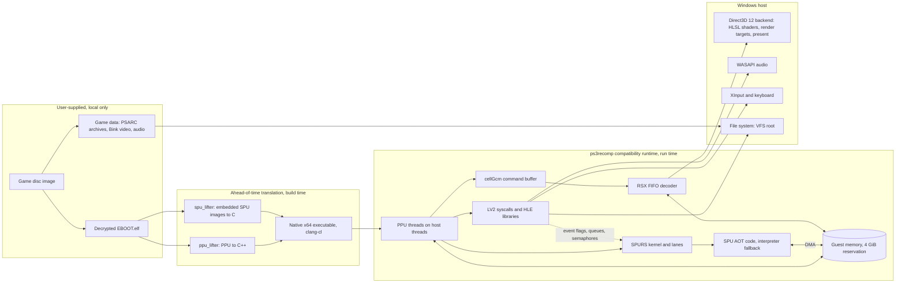

<p align="center">
  
</p>

<h1 align="center">MotorStorm: Pacific Rift — Native PC Recompilation</h1>

<p align="center">
  <strong>An experimental native Windows recompilation of the PlayStation 3 racing game, focused on accuracy, performance and preservation.</strong>
</p>

<p align="center">
  
  
  
  
  
</p>

> [!WARNING]
> **Experimental — Work in Progress. Not yet a playable release.**
> The original game reaches a race and renders it, but at roughly 4–5 frames per second, with known image
> faults and unverified simulation timing. There are no binaries to download, and none will be distributed.

---

## Contents

- [Overview](#overview)
- [Current status](#current-status)
- [Screenshots](#screenshots)
- [Architecture](#architecture)
- [Performance and fidelity](#performance-and-fidelity)
- [Building](#building)
- [Development and debugging](#development-and-debugging)
- [Roadmap](#roadmap)
- [Repository layout](#repository-layout)
- [Legal and attribution](#legal-and-attribution)

## Overview

**Static recompilation** translates a program's machine code into source code for another platform ahead of time,
once, and compiles it with a normal compiler. Here the PlayStation 3 game's PowerPC (PPU) code and its Cell
SPU programs are lifted to C/C++ by [ps3recomp](https://github.com/sp00nznet/ps3recomp) and built into a native
Windows x64 executable. The PS3 operating-system and library calls the game makes (threads, SPURS, file system,
audio, pad, GCM graphics) are provided by an independently written compatibility runtime, and RSX graphics
commands are translated to Direct3D 12.

**How this differs from emulation.** An emulator decodes and executes guest instructions while the game runs.
This project runs the *game's own logic, compiled natively*: the same functions, in the same order, with the same
data — but no instruction decoding on the hot path (a small SPU interpreter remains as a fallback for code that is
loaded at run time and not yet lifted).

**Why original behaviour matters.** MotorStorm's handling, physics and AI are the game. The project never
replaces them with approximations: no remade engine, no substitute physics, no skipped intro or forced menus.
When something is wrong, the fix goes into the compatibility layer, with a focused regression test.

**Assets stay outside the repository.** The repository contains only original project source, tools and
documentation. Each developer supplies their own game data locally; the decrypted executable, lifted source,
game assets, firmware and every build output stay in Git-ignored folders and are never committed or uploaded.

## Current status

Every row below is backed by a dated entry in [`docs/STATUS.md`](docs/STATUS.md) or a task report. *Not verified*
means no controlled run has established it yet.

| Area | State | Evidence and notes |
|---|---|---|
| PPU recompilation | ✅ Implemented | The whole decrypted executable is lifted ahead of time and links natively; original startup, frontend and races run. |
| SPU execution | 🟡 Partial | 26 embedded SPU images and observed overlays run as AOT translations; the SPURS Wws job still runs in the SPU interpreter (relocatable AOT is on an agent branch). |
| SPURS scheduling | 🟡 Partial | Host lanes, task sets, job chains and LFQueues run the original SPU work. Honouring the game's `maxContention` (five lanes) is on `agent/t134-…`. |
| Direct3D 12 rendering | 🟡 Partial | Splash, Bink intro, frontend, garage and race scenes render. Open faults: shoreline surf band, right-edge window, single-sampled 2x MSAA targets (fixes are opt-in on agent branches). |
| Texture loading | 🟡 Partial | Guest textures upload at level 0; mip chains and guest sampler state are opt-in (`RSX_TEX_MIPS`, `RSX_GUEST_SAMPLERS`). |
| Shader translation | 🟡 Partial | Guest vertex and fragment programs are translated to HLSL; captured race frames bind no fallback pipelines. FP16/FX12 precision is opt-in (`RSX_FP_PRECISION`). |
| Physics and simulation | ⚪ Not verified | Original code runs unmodified, but at 4–5 FPS its timing against real hardware is unmeasured; `PS3_SIM_PACE` is an experiment. |
| Audio | 🟡 Partial | WASAPI output; the Bink intro and in-game streams play through the guest mixer. Completeness and sync are not verified. |
| Input | 🟡 Partial | XInput, a keyboard fallback and scripted pads (`PAD_SCRIPT`) reach the race; full controller mapping is not verified. |
| Menus | 🟡 Partial | The main menu appears and a scripted route enters a race; interactive navigation of every page is not verified. |
| Modding framework | 🔵 Planned | Begins after the original offline race is correct and measurable. |
| Performance optimisation | 🧪 Experimental | Race ≈ 4–5 FPS (frames 193–243 ms) on an RTX 5060 + Ryzen 5 9600X. The critical path is one SPURS lane; candidate fixes await a controlled game run. |

Legend: ✅ implemented · 🟡 partially implemented · 🧪 experimental · 🔵 planned · ⚪ not verified.

## Screenshots

No screenshots are committed yet. Frames captured from the game show copyrighted game content, so they are added
only after the owner approves each image (see [CONTRIBUTING.md](CONTRIBUTING.md#screenshots)). Mock-ups and
generated images are never presented as gameplay.

| Gameplay | Rendering development |
|---|---|
| *Placeholder — an approved race capture goes in `docs/media/screenshots/`* | *Placeholder — an approved RSX diagnostic capture* |

## Architecture



The PPU, SPU and RSX sides share one guest address space, exactly as on the console; synchronisation goes
through the game's own primitives (event flags, LFQueues, GCM labels and flips). Details: [docs/ARCHITECTURE.md](docs/ARCHITECTURE.md).

## Performance and fidelity

| Goal | Meaning |
|---|---|
| Accurate original physics | The original simulation code runs unchanged; no constants, time steps or gameplay logic are altered. |
| Correct guest timing | Guest timers, vblank and flip pacing behave as the game expects. |
| Independent simulation and rendering | Where the game's design allows it, rendering cost must not slow the simulation (under study). |
| Faithful RSX behaviour | Render targets, samplers, depth/stencil state and MSAA as the console performs them. |
| Efficient PPU/SPU execution | AOT code everywhere, no host spinning, all SPURS lanes the game asks for. |

**Long-term target:** 1280×720 at 60 FPS on AMD Radeon 890M-class integrated graphics.
**Achieved today:** about 4–5 FPS in a race on an RTX 5060 desktop. The target is not met, and offline or synthetic
benchmarks in task reports are never quoted as game frame rates.

## Building

> [!IMPORTANT]
> A build needs your own legally obtained game data, decrypted on your own system. None is provided here.

| Requirement | Version used by the project |
|---|---|
| OS | Windows 11 x64 (other Windows versions not tested) |
| Compiler | Visual Studio 2026 x64 environment (MSVC linker, Windows SDK) and Clang 23 `clang-cl` |
| Build tools | CMake, Ninja, Python 3, Node.js |
| GPU | Direct3D 12 capable |
| Framework | `ps3recomp/` checkout (base `0fe7dbf`, the v0.15.0 package; project changes on its MotorStorm branches) |

Short version, from the workspace root:

```powershell
cmd /c tools\build_port.cmd          # full lift-to-link build of build\motorstorm
cmd /c tools\build_incremental.cmd   # rebuild after source changes
```

`build_port.cmd` expects the decrypted executable at `generated\decrypted\EBOOT.elf` and the extracted disc in
`original\game\`. Preparing those inputs, running the executable and the bounded probe scripts are covered step by
step in [docs/BUILDING.md](docs/BUILDING.md).

## Development and debugging

The runtime is configured through environment variables; all of them default to the original behaviour unless
stated otherwise. Many live only on agent branches until they are integrated — check the branch before relying
on one.

| Switch | Effect | Branch |
|---|---|---|
| `PS3_CRITICAL_PATH_TRACE` | Streams a PPU/SPU/RSX timeline; analyse with `ps3recomp/tools/cpath_report.py` | `agent/t134-ppu-spu-critical-path` |
| `PS3_SPURS_GUEST_MAXCONT` | `0` restores one Wws lane (default there: the game's `maxContention`) | `agent/t134-…` |
| `PS3_SPURS_EVENT_SCHED` | Event-driven SPURS lane wake-up (opt-in) | `agent/t134-…` |
| `PS3_SIM_PACE` | Simulation pacing experiment | `agent/t132b-framerate-independent` |
| `PS3_TEX_SNAPSHOT_EPOCH` | Skips re-hashing unchanged texture snapshots | `agent/t122-…`, `agent/t134-…` |
| `RSX_TEX_MIPS` | Uploads full guest mip chains | `agent/t133-…`, `agent/t137-…` |
| `RSX_GUEST_SAMPLERS` | Honours guest sampler state per texture unit | T113 line and later |
| `RSX_RT_WINDOW` | Samples render targets through the guest's declared window | `agent/t120-…`, T133, T137 |
| `RSX_DEPTH_STATE` | Applies guest depth-write, compare and stencil state | `agent/t120-…`, T133, T137 |
| `RSX_FP_PRECISION` | Clamps FX12/FX9/FP16 fragment results | `agent/t133-…`, T137 |
| `RSX_MSAA` | Renders the game's 2x MSAA targets multisampled | `agent/t137-rsx-msaa-fidelity` |

More switches, test suites and the trace tools: [docs/DEVELOPMENT.md](docs/DEVELOPMENT.md). Working rules for the
AI coding agents that develop the project: [AGENTS.md](AGENTS.md) and [docs/AGENT_WORKFLOW.md](docs/AGENT_WORKFLOW.md).

## Roadmap

1. Stable race execution
2. Accurate RSX image quality
3. Faster PPU/SPU execution
4. Correct simulation timing
5. Complete audio and input
6. Optional graphics enhancements
7. Modding support
8. Broader hardware compatibility
9. Packaging and installation (source-only, user-supplied data)

No dates are promised. Detail and exit criteria: [docs/ROADMAP.md](docs/ROADMAP.md).

## Repository layout

| Path | Contents | In Git |
|---|---|---|
| `docs/` | Status log, research notes, architecture, build and workflow guides | yes |
| `tools/` | Build, probe, analysis and audit scripts | yes |
| `port/` | The MotorStorm port project (CMake, entry point, port-specific runtime glue) | yes, without lifted code |
| `generated/analysis/<task>/` | Per-task reports and analysis scripts | reviewed `*.md` / `tools/*.py` only |
| `ps3recomp/` | Recompiler and runtime (separate repository, MotorStorm branches) | separate repository |
| `original/`, `generated/`, `build/` | Game inputs, lifted code, captures, builds | **never** |

## Legal and attribution

This is an independent, unofficial technical project. It is **not affiliated with, endorsed by or sponsored by**
Sony Interactive Entertainment, Evolution Studios or any MotorStorm rights holder. "MotorStorm", "PlayStation" and
related names are trademarks of their respective owners and are used only to identify the software being studied.

The repository does not contain, and must never contain, game files, firmware, decryption keys, extracted assets or
code lifted from the game. You must supply your own legally obtained game data. Whether extracting, decrypting or
using that data is lawful depends on your jurisdiction; owning a disc does not by itself authorise every method of
extraction, circumvention or distribution. See [docs/DISTRIBUTION.md](docs/DISTRIBUTION.md).

Third-party components and their licences — ps3recomp (MIT), the vendored ATRAC decoder (LGPL-2.1-or-later) and the
locally installed tools — are listed in [THIRD_PARTY_LICENSES.md](THIRD_PARTY_LICENSES.md). Security reports:
[SECURITY.md](SECURITY.md).
